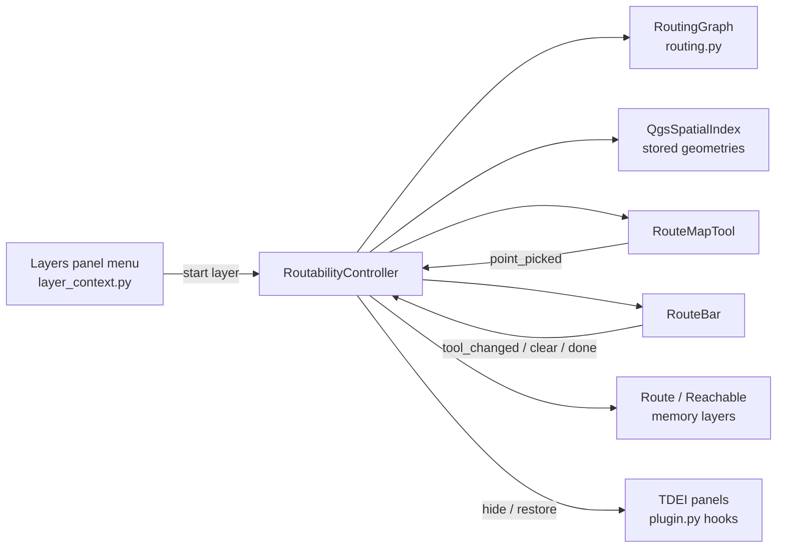

# Routability — Technical Design

How the TDEI plugin checks whether a destination can be reached from a start edge on an OSW edges layer, and draws the route over the map.

For end-user steps, see [USER_HANDBOOK.md](USER_HANDBOOK.md#check-routability).

---

## Contents

1. [Overview](#1-overview)
2. [Components](#2-components)
3. [Session flow](#3-session-flow)
4. [Graph model](#4-graph-model)
5. [Picking and snapping](#5-picking-and-snapping)
6. [Path selection (Dijkstra)](#6-path-selection-dijkstra)
7. [Distance calculation](#7-distance-calculation)
8. [Output layers](#8-output-layers)
9. [Lifecycle and integration](#9-lifecycle-and-integration)
10. [Performance](#10-performance)
11. [Limitations](#11-limitations)
12. [Testing](#12-testing)
13. [Extending](#13-extending)

---

## 1. Overview

The user picks a **start edge** and a **destination point** on the map. The plugin then:

1. builds an undirected graph from the edges layer, where `_u_id` and `_v_id` are the node ids at each end of an edge
2. snaps the start click to an edge and the destination click to a point on the nearest edge
3. runs a multi-source, multi-target Dijkstra search weighted by length in metres
4. writes the result to a memory layer drawn above all other layers

If no route exists, it writes the edges reachable from the start edge instead.

The routing core (`features/osw/routing.py`) is pure Python with no QGIS imports, so it can be unit-tested outside QGIS.

---

## 2. Components

| File | Role |
|------|------|
| `features/osw/routing.py` | `RoutingGraph` (adjacency, Dijkstra, reachability), `RouteResult`, field-name constants, node-id normalisation. No QGIS imports. |
| `qgis/routability.py` | `RoutabilityController`: builds the graph and spatial index, snaps clicks, computes routes, manages output layers and rubber bands, handles the session lifecycle. Also `is_edges_layer()` and `find_edges_layer()`. |
| `qgis/route_map_tool.py` | `RouteMapTool` (`QgsMapTool`) with interactions `start`, `dest`, `pan`, `zoom_in`, `zoom_out`. Emits `point_picked(mode, QgsPointXY)` in canvas CRS. |
| `ui/dialogs/route_bar.py` | `RouteBar`: floating toolbar with tool strip, hint, result text, **Clear** and **Done**. Reuses the clip toolbar stylesheet (`BBoxConfirmBar._stylesheet()`). |
| `qgis/layer_context.py` | Adds **TDEI Routability…** to the Layers panel context menu. |
| `plugin.py` / `core/services/container.py` | Creates the controller and exposes it as `container.routability`. Finishes the session on unload. |
| `ui/icons/tool_route_start.svg`, `tool_route_dest.svg` | Toolbar icons. |
| `tests/unit/test_osw_routing.py` | Unit tests for the routing core. |



---

## 3. Session flow

```mermaid
sequenceDiagram
    actor User
    participant Menu as Layers menu
    participant Ctl as RoutabilityController
    participant Tool as RouteMapTool
    participant Graph as RoutingGraph
    participant Map as QGIS project

    User->>Menu: TDEI Routability…
    Menu->>Ctl: start(edges_layer, title)
    Ctl->>Graph: build from features (_u_id, _v_id, length)
    Ctl->>Ctl: build QgsSpatialIndex, hide TDEI panels
    Ctl->>Tool: set as canvas map tool (interaction = start)
    User->>Tool: click near an edge
    Tool->>Ctl: point_picked("start", pt)
    Ctl->>Ctl: nearestNeighbor within 10 px → start edge, green band
    Ctl->>Tool: interaction = dest
    User->>Tool: click destination
    Tool->>Ctl: point_picked("dest", pt)
    Ctl->>Ctl: snap to nearest edge, red marker
    Ctl->>Graph: shortest_path(sources, targets)
    alt route found
        Ctl->>Map: write "Route — name" layer
    else no route
        Ctl->>Graph: reachable_edges(start nodes)
        Ctl->>Map: write "Reachable — name" layer
    end
    User->>Ctl: Done / Esc
    Ctl->>Ctl: remove tool, bands, toolbar; restore panels
```

Clicking a new destination recomputes the route. Picking a new start edge while a destination is set also recomputes it. **Clear** removes the start, destination, bands and output layers.

---

## 4. Graph model

### Edges layer requirements

`is_edges_layer(layer)` accepts a layer when all of these hold:

- it's a valid `QgsVectorLayer` with **line** geometry
- it has fields `_u_id` and `_v_id`
- it isn't a routability output layer (`tdei_routability` custom property unset)

`find_edges_layer(layers)` picks from a dataset group. It prefers a layer whose source file follows OSW naming as `*.edges.geojson`, and otherwise takes the first matching line layer.

| Field | Use | Required |
|-------|-----|----------|
| `_u_id` | Node id at the start of the line | Yes |
| `_v_id` | Node id at the end of the line | Yes |
| `_id` | Edge id shown in results (`edge_id`) | No |
| `length` | Edge length in metres; used when > 0 | No |

### Structure

```python
RoutingGraph.adjacency: Dict[node_id, List[(neighbor_id, edge_key, weight)]]
RoutingGraph.edges:     Dict[edge_key, (u_id, v_id, weight)]
```

- `edge_key` is the QGIS feature id (`fid`), so geometry can be looked up in the spatial index.
- Each edge is added in **both directions**, making the graph **undirected**. Self-loops (`u == v`) are stored once.
- Parallel edges between the same two nodes are allowed. Each keeps its own key and weight.
- Edges with an empty `_u_id` or `_v_id` are skipped.

### Node id normalisation

GeoJSON ids may load as integers, floats or strings. `normalize_node_id()` maps them to one form:

| Input | Normalised |
|-------|-----------|
| `12` | `"12"` |
| `12.0` | `"12"` |
| `" 12 "` | `"12"` |
| `None`, `"NULL"`, `"None"` | `""` (edge skipped) |

---

## 5. Picking and snapping

When the graph is built, the controller also builds a `QgsSpatialIndex` with `FlagStoreFeatureGeometries`. The index then holds every edge's geometry, so:

- `nearestNeighbor(point, 1, maxDistance)` uses **exact geometry distance**, not just bounding boxes
- `index.geometry(fid)` returns an edge's geometry without another read from the layer

Clicks arrive in canvas CRS and are transformed to the edges layer CRS with `QgsCoordinateTransform`.

### Start edge

- Tolerance is **10 screen pixels**. It's converted to layer units by transforming the click and a point 10 × map-units-per-pixel to the right, then measuring between them in layer CRS.
- `nearestNeighbor(point, 1, tolerance)`. If nothing is found, the status bar asks the user to click on an edge line.
- The click is snapped onto the edge (`lineLocatePoint` → `start_along`, then `interpolate`) and shown as a **green circle** at that spot. The edge itself isn't highlighted.
- `start_along` is used **only for drawing** (see [section 7](#7-distance-calculation)). Path selection still treats the whole start edge as the start.

### Destination

- `nearestNeighbor(point, 1)` with **no distance limit**, so the closest edge is always used.
- The position along that edge is `along = geom.lineLocatePoint(point)`, in layer units.
- The snapped point is `geom.interpolate(along)`, shown as a red circle `QgsRubberBand`.

---

## 6. Path selection (Dijkstra)

### Turning picks into sources and targets

The start is a whole edge and the destination is a point partway along an edge. Both become node sets with entry or exit costs:

```text
sources = { start_u: 0,                     start_v: 0 }
targets = { dest_u:  fraction × dest_len,   dest_v:  (1 − fraction) × dest_len }
```

`fraction` is how far along the destination edge the snapped point lies (see [section 7](#7-distance-calculation)). This assumes the line geometry runs from `_u_id` to `_v_id`, which is the OSW convention.

It's the same as adding a virtual source node joined to both start nodes at cost 0, and a virtual target node joined to both destination nodes at the partial costs, then running ordinary single-pair Dijkstra.

### Algorithm

`RoutingGraph.shortest_path(sources, targets)`:

1. Seed a min-heap with each source node at its entry cost.
2. Pop the node with the smallest distance. Skip it if already settled.
3. **Stop** when the popped distance is at least the best total found so far; no remaining node can improve it.
4. Settle the node. If it's a target, set `candidate = dist + exit_cost`, and keep it if it's cheaper than the best.
5. Relax neighbours. On a shorter distance, record `prev[neighbor] = (node, edge_key)` and push the neighbour.
6. When the heap is empty, or the stop rule fires, follow `prev` back from the best target node to a source and reverse the list.

The result is a `RouteResult` with:

| Field | Meaning |
|-------|---------|
| `edge_keys` | Edges walked between the start edge and the destination edge, in order |
| `nodes` | Node ids from the start node to the target node |
| `cost` | Path length + exit cost at the target (metres) |
| `target_node` | Which end of the destination edge was reached (`dest_u` or `dest_v`) |

A counter breaks ties in the heap, so node ids are never compared. Equal-cost paths always resolve the same way.

### Special cases

| Case | Behaviour |
|------|-----------|
| Destination on the start edge | One row: the piece of the start edge between the two clicked points |
| Start clicked exactly on the departure node | The zero-length start piece is skipped |
| Start node is also a target | Empty `edge_keys`; cost = exit cost |
| Path already includes the destination edge | No extra partial segment is added |
| No path (separate islands) | `shortest_path` returns `None`; reachability is drawn |

### Reachability fallback

`RoutingGraph.reachable_edges(sources)` is an iterative depth-first walk from the start edge's two nodes. It collects every edge in that connected component and writes them to the **Reachable** layer. Any route layer for this source is removed first.

---

## 7. Distance calculation

### Edge weight (metres)

Each edge's weight is set once, while the graph is built:

1. If the feature has `length` > 0, that value is used. OSW `length` is in metres.
2. Otherwise it's measured with `QgsDistanceArea`, using the layer CRS as the source CRS and the **WGS84** ellipsoid. `measureLength()` then returns **ellipsoidal metres** in any CRS, including EPSG:4326, where planar length would be in degrees.

### Partial destination edge

```text
geom_len  = destination geometry length          (layer units)
along     = lineLocatePoint(snapped point)       (layer units)
fraction  = min(1, along / geom_len)
partial_m = fraction × dest_len_m                (if reached via _u_id)
          = (1 − fraction) × dest_len_m          (if reached via _v_id)
```

The fraction is a **proportional** estimate: it assumes metres are spread evenly along the line in layer units. For short sidewalk edges the error is negligible.

The drawn geometry is cut with `QgsAbstractGeometry.curveSubstring(start, end)`:

- reached via `_u_id`: `[0, along]`
- reached via `_v_id`: `[along, geom_len]`

For a multi-part edge, the first part is used. If cutting fails, the whole edge is drawn.

### Partial start edge (display)

Path selection starts from **both** ends of the start edge at cost 0, so the choice of route doesn't depend on where the edge was clicked. The **drawn** start piece runs from the clicked point to the node the route leaves from (`RouteResult.nodes[0]`):

- leaves via `_u_id`: `[0, start_along]`
- leaves via `_v_id`: `[start_along, start_geom_len]`

Its `length_m` is scaled by the same proportional fraction as the destination piece. If the click is exactly on the departure node, the piece has zero length and isn't written.

### Route total

The reported total is the sum of the **drawn** row lengths:

\[
\text{total} = \text{partial start} + \sum \text{len(path edges)} + \text{partial destination}
\]

Each output row stores its own `length_m`. The toolbar shows `N edge(s), D`, where N is the number of drawn rows, and D is in m below 1 km and in km above.

**Example:** three 111.32 m edges in a row. The start is clicked halfway along the first and the destination halfway along the third, so the total is 55.66 + 111.32 + 55.66 ≈ **223 m**.

If the destination is on the start edge, a single row runs between the two clicked points.

---

## 8. Output layers

Both outputs are **memory** layers of type `MultiLineString`, in the CRS of the edges layer. They're inserted at **index 0 of the layer tree root**, so they draw above everything else, and are kept separate from the `TDEI` dataset groups so the Mapped tab ignores them.

| Layer | Name | When |
|-------|------|------|
| Route | `Route — <title>` | A path was found |
| Reachable | `Reachable — <title>` | No path; shows the start edge's connected component |

Only one of the two exists for a given edges layer at a time.

### Custom properties

| Property | Value |
|----------|-------|
| `tdei_routability` | `route` or `reachable` |
| `tdei_routability_source` | Edges layer id |

The controller uses these to find and reuse its layers. Each new route truncates and refills the same layer instead of adding another one. `is_edges_layer()` also checks them, so an output layer is never offered as a routing source.

### Fields

| Field | Type | Content |
|-------|------|---------|
| `seq` | int | Order along the route (1 = start edge). `0` in the Reachable layer. |
| `role` | string | `start`, `path`, `destination`, or `reachable` |
| `edge_id` | string | `_id` of the source edge, when present |
| `_u_id` | string | Start node id of the edge |
| `_v_id` | string | End node id of the edge |
| `length_m` | double | Metres. Scaled for the partial destination segment. |

Geometries are converted to multi-part before being added, to match the provider type.

### Styling

| Layer | Symbol |
|-------|--------|
| Route | White casing 2.8 mm under an orange (`#FF6D00`) core line 1.6 mm, round caps and joins |
| Reachable | Purple (`98,0,234,170`) line 1.2 mm |

During the session only, rubber bands mark the snapped start point (green circle, 14 px) and the snapped destination (red circle, 14 px).

---

## 9. Lifecycle and integration

### Entry point

`LayerContextMenuController._on_layer_tree_menu` adds **TDEI Routability…** when the right-clicked node is:

- an edges layer, or a group containing one (non-TDEI layers included), or
- any node inside a TDEI dataset group whose layers include an edges layer

The layer-tree handler is now always connected. Only the **TDEI Jobs** submenu still depends on the `jobs` feature flag.

The menu calls `container.routability.start(layer, title)`. For TDEI datasets, the title is the cached display name followed by the layer name.

### Start

1. Finish any running routability session.
2. Validate the layer with `is_edges_layer`.
3. Cancel an active clip session (`container.bbox_capture`).
4. Build the graph and spatial index inside `busy_action` (status bar progress and wait cursor).
5. Hide the TDEI panel, map search and map chrome with `container.hide_map_panels()`, remembering what was visible.
6. Save the current map tool and install `RouteMapTool`.
7. Watch `canvas.mapToolSet` and `QgsProject.layerWillBeRemoved`.
8. Show `RouteBar` at the top-left of the canvas.

### Finish

Triggered by **Done**, **Esc**, choosing another map tool, removal of the edges layer, starting a new session, or plugin unload. It:

- disconnects the watchers
- removes the toolbar and rubber bands
- restores the previous map tool, but only if ours is still active
- drops the graph and index
- restores the panels with `container.restore_map_panels(state)`

**Output layers are left in the project.**

### Interaction sync

The toolbar and the map tool stay in step:

- toolbar → `tool_changed` → `RouteMapTool.set_interaction`
- map tool → `interaction_changed` → `RouteBar.set_tool`, without re-emitting

After a start edge is picked, the interaction switches to `dest` automatically. Middle-button drag pans in every interaction.

---

## 10. Performance

| Step | Cost |
|------|------|
| Graph + index build | One pass over features, O(E). Requests only `_u_id`, `_v_id`, `_id`, `length` plus geometry. Ellipsoidal measuring is used only when `length` is missing. |
| Snapping | R-tree nearest neighbour, about O(log E) |
| Dijkstra | O((E + V) log V) worst case. Stops once no remaining node can beat the best target. |
| Reachability | O(E + V) for the connected component |
| Rendering | Geometry comes from the index, with no layer re-read |

The build runs on the UI thread (QGIS vector layers aren't thread-safe to read in parallel) and happens **once per session**. Routes within a session reuse the graph. Edits to the edges layer during a session aren't picked up; restart the tool to rebuild.

---

## 11. Limitations

| Limitation | Notes |
|------------|-------|
| Undirected | Right for pedestrian ways. One-way rules aren't applied. |
| Shortest distance only | No incline, curb, surface, width, or barrier rules |
| Route choice uses the whole start edge | Both ends are free starts, so the route may leave by the end farther from the click. The drawn piece and the distance still start at the click. |
| Unlimited destination snap | Far-away clicks still snap to the nearest edge |
| Connectivity from node ids only | Lines that touch but don't share a node id aren't connected |
| Proportional partial length | Fraction measured in layer units, scaled to metres |
| Geometry direction assumed u → v | Used to pick which part of the destination edge to draw |
| Multi-part edges | Only the first part is used when cutting the destination segment |
| Single active session | Starting a new session closes the previous one |

---

## 12. Testing

### Unit tests

```bash
python3 -m unittest tests.unit.test_osw_routing -v
```

These cover:

- node-id normalisation
- field detection
- skipping invalid edges
- cheapest path selection
- undirected travel
- target exit costs choosing the better end
- multiple sources
- source equal to target
- no route between islands
- reachability

### QGIS headless smoke test

Run with QGIS's Python. The plugin folder must **not** be first on `sys.path`, because its `qgis/` and `logging/` packages would shadow the real ones:

```bash
cd /tmp
QGIS_PREFIX_PATH=/Applications/QGIS.app/Contents/MacOS \
PYTHONPATH=/Applications/QGIS.app/Contents/Resources/python \
/Applications/QGIS.app/Contents/MacOS/bin/python3 your_smoke_script.py
```

A smoke script can:

1. create a memory `LineString` layer with `_id`, `_u_id`, `_v_id`
2. call `RoutabilityController._build_graph`
3. set `_start_fid`
4. call `_pick_destination`
5. assert on the `tdei_routability` output layers

### Manual checks

1. Right-click an edges layer and confirm **TDEI Routability…** appears.
2. Pick a start edge, then a destination. Check the orange route and the toolbar distance.
3. Pick a destination on a disconnected part of the network. Check that the purple Reachable layer appears.
4. Use **Clear**, **Done**, Esc, and switch to another map tool. Check the panels come back each time.
5. Remove the edges layer mid-session. The tool should close.

---

## 13. Extending

| Goal | Where to change |
|------|-----------------|
| Accessibility profiles (max incline, avoid raised curbs, …) | Filter or re-weight edges in `RoutabilityController._build_graph` before `graph.add_edge`. Use `float("inf")` or skip the edge to forbid it. |
| Directed edges / one-way rules | Add a `directed` flag to `RoutingGraph.add_edge` that skips the reverse adjacency entry |
| Choose the route from the clicked start point | In `_compute_route`, use `sources = {u: f × len, v: (1 − f) × len}` with `f = start_along / start_geom_len`. Drawing already cuts the start edge at the click. |
| Destination snap limit | Pass a `maxDistance` to `nearestNeighbor` in `_pick_destination`, and warn when nothing is in range |
| Node-based snapping | Index the `*.nodes.geojson` layer and snap to the nearest node id |
| Very large datasets | Build adjacency through a `QgsVectorLayerFeatureSource` in a `QgsTask`, then hand the graph back to the UI thread |
| Export route | Output is a normal memory layer, so **Export → Save Features As…** works. Could add a toolbar button. |
